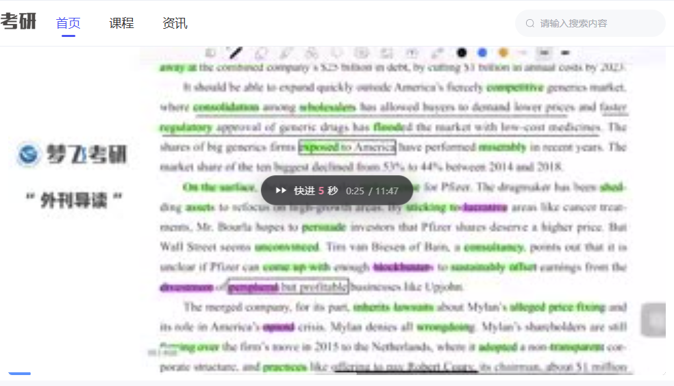
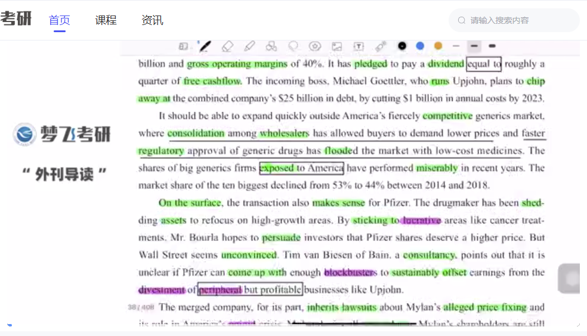
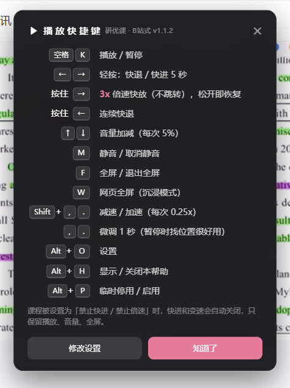

# 研优课（ky.mfedu.cn）B 站式播放控制

给研优课的课程播放器加上 B 站风格的快捷键 / 手势，个人自用。

仓库里两个独立脚本，按设备各装各的：

| 脚本 | 平台 | 交互 |
| --- | --- | --- |
| `ky-bilibili-player.user.js` | PC（Nuxt 页面） | 键盘快捷键 |
| `ky-bilibili-mobile.user.js` | 手机（`/wap` 的 uni-app H5） | 触摸手势 |

PC 版在纯触摸设备上会自动让位，两个都装也不会打架。

| 按住 `→` 倍速 | `←` / `→` 快进快退 |
| --- | --- |
|  |  |

---

## 手机版（触摸手势）

手机端其实是**另一套页面**：UA 带 Mobile 时服务器返回 `/wap` 下的 uni-app H5 应用，播放器是原生 `<video>`（不是 PC 那套 canvas + ffplayer）。所以手机用的是单独一个脚本 **`ky-bilibili-mobile.user.js`**。

| 手势 | 功能 |
| --- | --- |
| **长按画面** | 倍速播放（取平台白名单最大档，一般为 2x），松手立刻恢复 |
| 双击左侧 1/3 | 快退 10 秒 |
| 双击右侧 1/3 | 快进 10 秒 |
| 双击中间 | 播放 / 暂停 |
| 横向拖动 | 调进度，松手生效（拖动时实时显示目标时间）|
| 右半屏上下滑 | 调音量 |
| 点右上角「1.0x」角标 | 在平台白名单内循环切倍速（0.5 → 0.75 → 1 → 1.25 → 1.5 → 2）|

> **为什么手机端最高只到 2x？**
> 手机用的百家云 SDK（1.10.68）里有个防篡改检查：`ratechange` 时如果 `playbackRate` 不在 `options.rateList` 白名单内，就直接 `pause()` 并弹「检测到使用外部倍速插件，请停止使用后刷新重试，错误码：1000」。
> PC 用的 `latest` 版本没有这段检查，所以电脑版仍然可以 3x。手机端脚本把倍速**严格夹在白名单内**，因此不会触发；课程没开倍速（白名单为空/只有 1x）时，倍速功能会整块禁用，角标变成 🔒。

说明：

- **亮度手势没做**（按需跳过），左半屏上下滑不劫持、页面照常滚动；
- **单击不拦截**，交给播放器原本的控件；底部控件条不会被手势层盖住；
- **横屏全屏和竖屏内联都可用**；
- 只在触摸设备上启用，PC 上完全不动。

### 手机上怎么装（Android）

1. 装一个能装扩展的浏览器：**Kiwi Browser**、**Lemur Browser**、**Edge Canary** 之类；
2. 在里面装 **Violentmonkey**（或 Tampermonkey）；
3. 打开 `https://ky.mfedu.cn`（会自动进 `/wap/`），点脚本安装链接；
4. **刷新一次**，视频右上角会出现「1.0x」角标。

iOS 需要在 Safari 里装「Userscripts」扩展；但 iOS 的 `<video>` 进入系统全屏后，页面层手势会被系统播放器接管，只能在内联播放时生效。

---

## PC 版的原理：为什么普通脚本在这里不管用

研优课的课程视频走的是**百家云 BPlayer**（接口里 `vodPlatform === 2`）。它把视频用 ffmpeg（`ffplayer.wasm`）解码后画到 `<canvas id="bplayer-ffplayer">` 上：

```
div.bplayer-wrap
├── div.bplayer-media-wrap
│   ├── canvas#bplayer-ffplayer     ← 画面在这里，不是 <video>
│   └── audio.bplayer-audio
└── div.bplayer-feature-wrap        ← 进度条 / 倍速菜单 / 全屏按钮
```

所以网上那些"改 `video.currentTime` / `video.playbackRate`"的 B 站脚本在这里全部失效——**页面上根本没有 `<video>` 元素**。

BPlayer 的实例也只存在于 Vue 组件的闭包里，`window` 上取不到。本脚本的做法：

1. 在 `document-start` 阶段用 `Proxy` 劫持 `window.BPlayer` 构造函数，把每个 `new` 出来的实例存起来；
2. 按键时挑出"当前可见的那个实例"，调用它自带的 API：`seek()` / `setSpeed()` / `setVolume()` / `setFullScreen()`；
3. 顺便处理了两个坑：
   - `BPlayer.setSpeed()` 内部把倍速写死在 **0.5 ~ 2x**。脚本会先把目标速率塞进 `options.rateList`（播放器只认白名单里的值），再直接写底层 `video.playbackRate`，因此 3x / 4x 也能真正加速（实测 8x 仍可用）。
   - `seek()` 之后播放器会自动续播，**暂停状态下快进会被"弹回播放"**。脚本加了 1.2 秒的暂停守护，把它按回去。

如果某门课用的是保利威 / CC 视频（原生 `<video>`），脚本会自动退回原生控制，行为一致。

---

## 安装

1. 浏览器装 [Tampermonkey](https://www.tampermonkey.net/)（油猴）扩展；
2. 装脚本，二选一：
   - **一键装**：打开 [Releases](https://github.com/ZhuYiXuanNB/bettermfclass/releases/latest)，点 `ky-bilibili-player.user.js`，油猴会弹出安装；
   - **手动装**：油猴面板 → 「添加新脚本」→ 全选删掉模板内容 → 把本仓库 `ky-bilibili-player.user.js` 全文粘进去 → `Ctrl+S` 保存；
3. 打开研优课任意视频页面，**刷新一次**（脚本必须在播放器创建之前就位才能接管，安装前已经开着的页面要刷新）；
4. 右下角会弹一条「已启用 B 站式快捷键」的提示，按 `Alt+H` 可随时查看快捷键表。

脚本带了 `@updateURL` 指向本仓库 `main` 分支，以后仓库里升版本号，油猴会自动提示更新。

临时试用（不想装扩展）：在视频页按 `F12` → Console → 粘贴脚本内容回车即可（仅当前页面有效，刷新失效）。

---

## 快捷键

| 按键 | 功能 |
| --- | --- |
| `空格` / `K` | 播放 / 暂停 |
| `←` / `→` | 轻按：快退 / 快进 5 秒（默认 5 秒，可改） |
| **按住 `→`** | **3x 倍速快放，全程不跳转，松开立刻恢复原速** |
| 按住 `←` | 连续快退 |
| `↑` / `↓` | 音量加减 5% |
| `M` | 静音 / 取消静音 |
| `F` | 全屏 / 退出全屏（走百家云自己的全屏） |
| `W` | 网页全屏（沉浸模式，再按一次退出） |
| `Shift` + `,` / `.` | 减速 / 加速（每次 0.25x） |
| `,` / `.` | 微调 1 秒（暂停时找位置很好用） |
| `Alt` + `H` | 显示 / 关闭快捷键帮助 |
| `Alt` + `O` | 打开设置面板 |
| `Alt` + `P` | 临时停用 / 启用脚本 |

说明：

- **轻按和按住是两件事**：轻按 `→` 只跳 5 秒；按住 `→` 只加速，**不会额外跳一下**（按下时先不跳，等到超过「长按触发时间」就判定为按住）。两种操作互不叠加；
- **连按会合并**：连续快速按方向键时，脚本最多每 0.4 秒真正跳一次，剩下的位移攒起来一起跳。百家云解码器每次 seek 都要重开解码，一秒里连开十几次会让它长时间转圈、画面不动，合并之后就不会了；
- 暂停状态下按住 `→` 不会倍速（没意义），改为连续快进；
- 输入框、笔记编辑器里不会拦截按键；
- 页面里没有视频时脚本完全不介入，方向键照常滚动页面。



## 设置

按 `Alt+O` 打开设置面板，可以直接改：

- 快退 / 快进秒数（1–120）
- 按住 → 的倍速（1.25–8）
- 长按触发时间（80–1500 ms，默认 260 ms）
- 音量步长
- 屏幕提示浮层开关

设置存在浏览器 `localStorage`（key：`mfc-player-config`），改完立即生效，不用刷新。

## 屏幕提示

B 站风格的深色圆角浮层，位置跟随播放器（不是跟随浏览器窗口），全屏时自动搬进全屏元素里：

- 快进/快退：`▶▶ 快进 5 秒  0:12 / 11:47`
- 倍速：粉色常驻角标 `▶▶ 3x 倍速播放中 · 松开恢复`
- 音量：`🔊 65% ▬▬▬▬▭▭`
- 播放/暂停、倍速切换、微调也都有对应提示

---

## 已知限制

- **课程被设置为"禁止倍速 / 禁止拖动"时，脚本会尊重这个设置**：站点对这类课程会传 `enableDrag: false` 并把 `rateList` 清空，脚本检测到后自动关闭 `←/→`、`Shift+,/.`、`,/.` 和"按住 → 倍速"，只保留播放/暂停、音量、静音、全屏、网页全屏，并在第一次按方向键时提示一句「本课程设置为禁止快进 / 倍速」。
- **倍速上限**：百家云解码器实测到 8x 都能正常加速（设置里可调 1.25–8x，默认 3x）。
- **进度上报**：脚本只改本机的播放状态，不伪造任何观看进度上报；平台自己的"观看进度 / 观课记录"仍按它的规则走。
- **不涉及任何付费 / 鉴权**：脚本不加解密、不下载视频、不绕过登录。
- 站点改版（BPlayer 换 API）后可能会失效，改法在脚本头部注释里。

## 卸载

油猴面板里删掉脚本即可；如果想让设置也清干净，控制台执行 `localStorage.removeItem('mfc-player-config')`。

---

## 验证情况

脚本在**真实的百家云播放器**上做过自动化验证——真实键盘事件、真实 ffplayer 解码，不是 mock：

| 场景 | 断言 |
| --- | --- |
| PC 常规课程参数 | 39/39 |
| PC「禁止倍速 / 禁止拖动」参数 | 14/14 |
| PC 无播放器的普通页面（确认不干扰） | 4/4 |
| PC 真机：登录后打开的真实课程（3 小时回放） | 8/8 |
| **手机版手势**（真实 `<video>` + 真实触摸事件） | **14/14** |
| **手机版在真实 `/wap` 页面 + 真实手机（三星 S23+ / Via 浏览器）** | 长按 2x 不触发检测、双击 ±10s、拖动调进度、角标切倍速 全部通过 |

真机那一轮确认了：能抓到 BPlayer 实例、`→` 快进 5 秒、按住 `→` 稳定 3x、松开回 1x、`↑` 音量、空格暂停、`M` 静音、`Alt+H` 面板全部正常。

倍速是真的在加速（同一时段的 1x 基线对比：1x 两秒走 2.00 秒，3x 两秒走 6.00 秒），而且按住期间**时间轴不会跳变**——这条有单独的断言守着。

## 边界

- 仅供个人学习使用，请遵守平台的服务条款；
- 不碰鉴权、不解密、不下载视频、不伪造观看进度；
- 平台若明确禁止快进 / 倍速，脚本遵守该设置（见「已知限制」）。

## 许可证

[GPL-3.0](LICENSE)。可自由使用、修改、再分发；衍生作品需同样以 GPL-3.0 开源。
